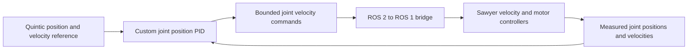

# Sawyer ROS 2 motion control

Move Sawyer's right arm to neutral or translate its end effector along a straight
Cartesian reference using **quintic trajectories and a custom PID controller**.
The application generates reference
joint positions and velocities, compares them with measured feedback, and sends
corrected joint velocity commands through the ROS 2–ROS 1 bridge.
The project also provides standard Intera electric-gripper commands, cuff button
bindings, and a live head-display clock.

## Quick start

Run these commands from the project root. Source the environment in every new
terminal; this file must be sourced so its settings apply to the current shell.

### Terminal 1: start the bridge

```bash
source scripts/env.sh
ros2 launch ./launch/sawyer.launch.py
```

Keep this running. The project launcher starts the bridge, active gripper
cuff-button bindings, and the display manager automatically. No separate button
command is needed. Upper/dash closes the gripper; lower/circle opens it.
The head screen shows the project's `display.png` until you start the clock.

It selects this project's `bridge.yaml`, enables arm/head command routes, and
waits for the gripper to be calibrated and ready. Starting the launcher does not
itself move or calibrate the gripper. Stop the launch with Ctrl+C to stop its
helpers and restore Sawyer's original SDK screen. Stop any old standalone button
controller or direct head-display publisher before using this launcher.

Use this project launcher for automatic buttons and display switching. The package-level
`ros2 launch sawyer_bridge bridge.launch.py` command still starts the bridge
alone. For diagnostics, disable automatic button bindings explicitly:

```bash
ros2 launch ./launch/sawyer.launch.py cuff_buttons:=false
```

### Terminal 2: preview a motion

```bash
source scripts/env.sh
python scripts/move_neutral.py --time 5
```

Preview prints current and neutral joint angles, the reference duration, and the
minimum feasible duration. **It sends no robot commands.** If five seconds is
too short for the current pose and limits, the script reports the required
minimum and exits.

### Terminal 2: execute the motion

With the robot enabled, stationary, and its path clear:

```bash
python scripts/move_neutral.py --time 5 --execute
```

The node does not enable or reset the robot. Keep the physical stop accessible.
Run one application commanding the arm; do not send Intera motion action goals
concurrently with this velocity controller.

### Minimum duration or reduced limits

Omit `--time` to use the minimum feasible duration for this quintic:

```bash
python scripts/move_neutral.py                 # preview
python scripts/move_neutral.py --execute       # execute
```

The default `--speed 1.0` permits the full published joint velocity limits. For
initial hardware tuning, preview and execute with reduced limits:

```bash
python scripts/move_neutral.py --speed 0.1 --max-accel 0.3
python scripts/move_neutral.py --speed 0.1 --max-accel 0.3 --execute
```

`--speed` scales the velocity limits, and `--max-accel` caps acceleration in
rad/s². Reducing either can increase the minimum duration. Requested times are
never silently lengthened.

## Relative Cartesian end-effector moves

Keep the project bridge running and run one arm-motion application at a time.
`move_ee.py` reads the current EE pose and applies relative offsets in
**centimeters** along the robot's **base-frame axes**. Orientation stays fixed.
For example, `z:+10` increases Z by 0.10 meters while retaining X/Y.

Preview a 10 cm upward move without sending motion commands:

```bash
source scripts/env.sh
python scripts/move_ee.py z:+10
```

Execute using the minimum feasible duration for the validated reference:

```bash
python scripts/move_ee.py z:+10 --execute
```

Or request a five-second reference:

```bash
python scripts/move_ee.py z:+10 --time 5 --execute
```

Combine offsets in one move:

```bash
python scripts/move_ee.py x:+5 y:-3 z:+10 --time 5 --execute
```

Each preview prints the selected tip/reference frame, start/target coordinates
in meters, planned/minimum duration, number of IK knots, and sampled FK error.
Preview calls read-only kinematics services but does not send joint commands.
A zero offset executes no motion.

### Cartesian planning and timing

The Cartesian reference follows:

```text
u = t / T
p(t) = start_position + offset * (10*u^3 - 15*u^4 + 6*u^5)
orientation(t) = start_orientation
```

This reference is a straight line with zero velocity and acceleration at both
ends. The planner seeds each IK request from the preceding joint solution and
rejects unreachable, self-colliding, or discontinuous solutions. It fits C2
piecewise quintic joint polynomials through the solutions, then checks FK at
knots and quarter/midpoints. Sampling is refined if the interpolation does not
meet the position/orientation tolerances. Polynomial joint-position extrema are
also checked between knots.

The desired Cartesian line is exact. Converting it to sampled joint references
introduces approximation: FK checks are sampled tolerance checks, not a proof of
continuous geometric accuracy or collision freedom. Default checked reference
tolerances are 1 mm position and 0.01 rad orientation. There is no workspace
obstacle-avoidance planner.

Minimum duration uses derivatives of the **whole IK joint path**, including
between-knot extrema, rather than only start/end joint displacement. For the
normalized joint reference `q(u)`:

```text
T_velocity     = max_joint(max_u(abs(dq/du)) / joint_velocity_limit)
T_acceleration = sqrt(max_joint(max_u(abs(d2q/du2)) / joint_acceleration_limit))
T_min          = max(T_velocity, T_acceleration)
```

This is the minimum uniform time scale for the constructed, validated joint
reference under independent joint limits. It is not a global time optimum over
all possible Cartesian motion profiles, and excludes planning and physical
settling. A shorter `--time` is rejected before commands are sent. `--speed` and
`--max-accel` reduce the bounds as in the neutral-move command.

IK/FK planning finishes before the PID loop starts; it makes no service calls
inside that loop. The shared joint PID uses reference velocity feedforward plus
position-error correction. Cartesian execution additionally stops on stale tip
feedback, position error above 0.02 m, or orientation error above 0.1 rad. Arrival
requires Cartesian error below 0.003 m and orientation error below 0.02 rad,
together with the normal joint/speed/settling criteria. PID gains remain
unvalidated on physical hardware; actual tracking can differ from the reference.

### Tool identification and options

By default, the node matches `/robot/limb/right/endpoint_state` against named
`/robot/limb/right/tip_states`. On this robot the matching tip is `right_hand`.
If matching is ambiguous, inspect the named tips and use `--tip NAME`.
The SDK pose headers on this installation can omit `frame_id`; the adapter uses
the SDK's `base` convention and verifies the starting pose against FK before
planning. It does not silently transform coordinates between frames.

The supplied bridge configuration explicitly includes the named tip-state route.
If it is missing from an older running bridge, restart the project launcher.

```bash
python scripts/move_ee.py --help
```

The neutral command's time, limit, PID, and timeout options also apply. Additional
CLI settings are:

| Option | Default | Meaning |
| --- | --- | --- |
| `--tip NAME` | Match endpoint | Select an advertised IK tip |
| `--step-mm VALUE` | `5` | Initial maximum Cartesian sample spacing |
| `--path-tolerance METERS` | `0.001` | Sampled FK position tolerance |
| `--max-cartesian-error METERS` | `0.02` | Runtime EE position-error abort bound |
| `--max-samples COUNT` | `401` | IK knot limit after refinement; at least 11 |
| `--ik-timeout SECONDS` | `2` | Per-request IK/FK timeout |
| `--planning-timeout SECONDS` | `60` | Overall kinematics planning budget |

### Reusable Python API

The Cartesian geometry, joint interpolation, and planner modules are independent
of ROS. The planner accepts IK/FK callables, so it can also be tested against a
simulator. For the ROS-connected API, from the project root:

```python
import rclpy
from scripts.cartesian_motion import CartesianMotionNode, CartesianMotionOptions

rclpy.init()
node = CartesianMotionNode()
try:
    result = node.move_relative(
        dx_cm=0, dy_cm=0, dz_cm=10,
        duration=5.0,                 # None selects the minimum feasible duration
        execute=False,                # True sends the motion commands
        options=CartesianMotionOptions(speed=0.25),
    )
    print(result.plan.trajectory.duration)
finally:
    node.destroy_node()
    rclpy.shutdown()
```

The method services ROS callbacks internally. Call it from application code,
not from a callback on the same single-threaded executor. An execution result
contains both the reusable plan and measured tracking/settling timing.

## Teach and replay pick and place

Two entry scripts share reusable planning, interaction, execution and plotting
helpers. Keep the project bridge running. Disable its gripper cuff-button
bindings for this workflow so only the teaching/replay script commands the gripper:

```bash
source scripts/env.sh
ros2 launch ./launch/sawyer.launch.py cuff_buttons:=false
```

In another sourced terminal, record a task with three middle points (zero is also
supported). The number excludes the pick and place poses:

```bash
source scripts/env.sh
python scripts/record_pick_place.py --middle-points 3 --file data/pick_place/task.json
```

**Recording opens the gripper automatically at startup.** It requires an already
calibrated gripper and sends gripper commands without needing `--execute`. It
does not command arm motion. After the gripper opens successfully, **starting a
new recording deletes the previous recording and generated outputs belonging to
the selected `--file`**: its task JSON, planned plot/data, replay PNGs, CSVs, plot
JSONs, and viewer logs. Cancellation after cleanup leaves no previous task at
that path. Use a different `--file` to retain another taught task.

Cleanup uses a task-specific artifact ownership manifest beside the recording,
including outputs previously written with `--output-dir`. Source scripts,
unrelated files and other tasks are preserved; directories are never recursively
deleted. Older generic `replay_<timestamp>` outputs are removed only when the
selected task is the only recording in that directory and their recorded
waypoints match. Ambiguous legacy outputs are preserved.

For each taught pose, hand-guide the arm, release
the cuff, stop the arm, and press Enter. The prompts are:

1. Record pick position, quaternion orientation and joint configuration.
2. Position the object and press Enter to close the gripper.
3. Record each numbered middle pose, one Enter per point.
4. Record the place pose.
5. Press Enter to open the gripper at place and finish teaching.

Immediately after release completes, the script saves the teaching data and
plans `pick → middle points → place → lift → neutral`, without moving the arm.
It saves the complete plan to the requested JSON file and a planned 3D PNG beside
it. If planning fails, that file retains the raw teaching data with
`status: recorded`; replay refuses it. A successful file has `status: planned`
and contains the actual IK knots, polynomial durations, joint limits, tool/frame,
recorded poses, and sampled FK references. Re-recording replaces the named file.

Preview a successful recording from the robot's current pose:

```bash
python scripts/replay_pick_place.py --file data/pick_place/task.json
```

Preview reads feedback and kinematics, validates the saved plan, and plans the
current-to-pick approach. It sends no arm or gripper commands. To execute:

```bash
python scripts/replay_pick_place.py --file data/pick_place/task.json --execute
```

Replay opens the gripper and moves from the current position/orientation to the
recorded pick pose using IK seeded from the preceding solution. A redundant arm
can reach that pose with different elbow/wrist joint angles. If the approached
pick joints differ from the saved plan, replay regenerates the transfer, lift,
and neutral joint references from that posture while preserving the recorded
Cartesian lines and orientations, capped limits, and minimum saved durations.
The original recording is unchanged. All planning and validation finish before
motion begins; an approach or transfer that cannot connect continuously is
rejected with its stage identified. At pick, replay waits
for Enter, giving you time to reset the object. After Enter it closes the
gripper, executes the saved transfer segments, confirms place arrival, opens the
gripper, and waits **two seconds after confirmed release**. It then lifts
**0.20 m along base-frame +Z with fixed orientation**, and returns to the
configured neutral joint pose using a smooth joint-space quintic.

Transfer uses **one continuous PID/velocity-control stream** through every
middle point to place. The controller retains its integral and acceleration-slew
state; it is not stopped, reset, or switched to position hold at middle points.
Each quintic still ends with zero reference velocity/acceleration, preserving
the exact taught Cartesian lines. At each middle point, the endpoint reference
is held only until arrival, low measured/commanded joint speeds, and two fresh
feedback samples spanning at least 0.02 s confirm the waypoint. The next segment
then starts in the same controller loop. This replaces the previous per-segment
mode handoff and repeated 0.2 s waits. The live plot continues to identify each
individual segment; terminal completion is printed after the stream stops.

Approach remains separate for the Enter/grasp pause. Place still requires the
full final settling and position-hold confirmation before release. After the
two-second release delay, lift and neutral share another uninterrupted stream.
At these stream boundaries, **0.2 seconds of settled, fresh feedback** is required
before motion and after the position-hold handoff. `--settle-time` (default 5 s)
remains the maximum extra settling allowance for each segment, rather than a
fixed delay. Readiness, feedback freshness, joint/Cartesian tracking errors, and
per-segment timeouts stay enforced throughout the connected motion.

Arm and gripper callbacks share one persistent ROS executor throughout teaching,
keyboard waits, gripper commands, and replay. Waiting at the Enter prompt keeps
Cartesian, joint, and IO feedback updating. Before a new controller stream, replay also
reacquires a current tip pose with a bounded wait, then verifies the planned
start pose and stationary feedback. Genuine stale feedback during motion still
stops the controller under the existing 0.2-second freshness limit.

Transfer, lift, and approach use straight Cartesian position segments and
shortest quaternion SLERP with quintic time scaling. Joint-space interpolation
is checked against Cartesian references through sampled FK. Every waypoint is
a rest point with zero reference velocity and acceleration. A `round_corners()`
placeholder in `scripts/pick_place_plan.py` documents future bounded corner
blending; it is deliberately not active yet.

Timing uses the full published joint velocity and acceleration limits by
default. It is the shortest uniform time scale for each constructed quintic
joint reference, rather than a global optimum over arbitrary profiles. To
reduce speeds for either recording/planning or replay, use:

```bash
python scripts/replay_pick_place.py --file data/pick_place/task.json --speed 0.1 --max-accel 0.3 --execute
```

Replay reconstructs the saved polynomials, checks continuity and extrema,
rechecks FK/self-collision and Cartesian tolerances against the current robot,
and verifies that the configured neutral pose has not changed. Lower current
limits or requested speed caps lengthen segment durations; replay never
increases the saved velocity/acceleration limits or shortens saved timings.
The approach is newly planned each run; the remaining joint references are
regenerated only when needed to connect its endpoint to the saved path.
These checks are sampled and do
not provide workspace obstacle avoidance. Ensure the taught straight segments,
initial approach, and neutral return have clearance. Physical tracking still
depends on PID tuning and the bridge, as described above.

Each preview/replay writes uniquely named `<task>_replay_<UTC timestamp>.png` and
`.plot.json` files beside the plan (or under `--output-dir`). Executed replay
also writes a CSV of timestamped **measured EE XYZ/quaternion, joint positions
and joint velocities**, Cartesian references, joint references, and
`tracking`/`settling`/`waiting` events. The PNG overlays
recorded waypoint markers, planned FK paths, and measured EE paths with equally
scaled X/Y/Z axes in meters. Neutral return uses a joint-space reference, so its
Cartesian reference fields in CSV are blank; its planned FK path appears in the
PNG. Partial measurements are exported after a failed/interrupted replay.

By default, executed replay opens a **live, rotatable 3D desktop window** before
motion starts. Dashed lines show the plan; solid lines show measured feedback,
and the red marker shows the latest measured EE position. Left-drag rotates the
view, right-drag zooms, and the toolbar can save the current view. Rotation and
zoom are preserved as new measurements arrive. The same window remains open
after successful or interrupted execution, with the full saved measurement
trace loaded for inspection. Preview opens an interactive window after planning.

The GUI and plotting run in separate processes. The arm loop only offers samples
to a bounded queue; a slow or closed window never blocks joint commands. Live
display may skip points when overloaded, but the saved JSON/CSV retains every
collected row. PNG export runs after control stops. The helper automatically
selects the ROS Python or system `/usr/bin/python3` with Matplotlib; the latter
provides Matplotlib/Tk on this installation without changing the ROS environment.

To reopen a saved run as a rotatable 3D view, from either Python environment:

```bash
python scripts/pick_place_plot.py data/pick_place/task_replay_<timestamp>.plot.json --show
```

Use `--no-live-plot` to show only the final interactive view, or
`--no-live-plot --no-show-plot` to save files without opening windows. Use
`--no-show-plot` alone to close the live window when replay ends. Without a
desktop display, files are saved for later viewing. Viewer startup problems are
reported in the run's `.viewer.log` file and do not disable motion checks.
`--help` lists planning, timing, PID, timeout and output options.

## Head display and live clock

The project launcher manages the head display automatically:

| Event | Screen |
| --- | --- |
| Start `ros2 launch ./launch/sawyer.launch.py` | Project `display.png` |
| Start `python scripts/head_clock.py` | Live clock |
| Stop the clock with Ctrl+C or `kill <clock-pid>` | Project `display.png` |
| Clock is force-killed with `kill -9` | Project `display.png` after its 2.5-second lease expires |
| Stop the bridge/launcher | Original Sawyer SDK screen |

With the project launcher running, start the clock in another sourced terminal:

```bash
source scripts/env.sh
python scripts/head_clock.py
```

It displays a 24-hour `HH:MM:SS` clock, date, and timezone on Sawyer's 1024×600
head screen. The default timezone is **America/Chicago**, including automatic
CDT/CST daylight-saving changes. It reads the Pi's wall clock rather than ROS
simulation time and sends one `bgr8` image per second to the display manager.
The manager is the single writer to `/robot/head_display`; that route is already
enabled in `bridge.yaml`.

Keep the clock process running for live updates; Ctrl+C returns to `display.png`.
The clock exits when its bridge/display-manager session ends, so it cannot take
over a later bridge session. Use one clock at a time. The clock sends no arm,
gripper, or head-pan commands and starts only when requested.

Choose a different IANA timezone or a limited running time:

```bash
python scripts/head_clock.py --timezone UTC
python scripts/head_clock.py --duration 10
```

Generate a local PNG preview without connecting to ROS:

```bash
python scripts/head_clock.py --preview /tmp/sawyer_clock.png
```

Rendering uses NumPy and the Python standard library; Pillow, OpenCV, and
`cv_bridge` are not required. The clock waits for the display manager. The
package-only `ros2 launch sawyer_bridge bridge.launch.py` command does not start
that manager; use the project launcher above. To add display management to an
already running bridge without restarting it, run this in another terminal and
keep it running:

```bash
source scripts/env.sh
python scripts/display_manager.py
```

Replace `display.png` to change the startup image, then restart the display
manager/launcher. It accepts noninterlaced 8-bit PNGs and fits other resolutions
inside 1024×600. The original SDK image is bundled as
[`assets/default_display.png`](assets/default_display.png), with its upstream
license. Startup paths can also be overridden:

```bash
ros2 launch ./launch/sawyer.launch.py display_image:=/absolute/path/image.png
# Disable automatic display management:
ros2 launch ./launch/sawyer.launch.py display_manager:=false
```

Shutdown restoration uses a separate ROS 1 image connection, so it can still
restore the SDK screen after the bridge process has exited. Keep the robot
network connected during shutdown. A power loss or `kill -9` of the display
manager itself prevents cleanup; stopping only the clock with `kill -9` is
handled by its lease. Allow several seconds for bridge shutdown restoration.

## Gripper and cuff buttons

[gripper_control.py](scripts/gripper_control.py) controls the standard Intera
electric gripper through IO signals. It uses the gripper's built-in controller,
independently of the custom arm PID. It does not support ClickSmart/vacuum or
other grippers with different signal schemas.

### 1. Automatic button startup

Start the project with the Terminal 1 command above. It launches the controller
internally in active button mode with persistent readiness waiting. If the
bridge is still starting, the gripper is uncalibrated, or the device is not
ready, the controller stays running and reports what it is waiting for. It
activates automatically when ready, and discards presses received while waiting.

`bridge.yaml` includes `/io/robot/cuff/state` with reliable, transient-local QoS
so the listener receives the current state. If replacing an older running bridge,
restart it using the new project launcher to apply this route.

### 2. Inspect and calibrate the gripper

In another terminal:

```bash
source scripts/env.sh
python scripts/gripper_control.py status
```

Inspect `is_calibrated`, `has_error`, and the device status when troubleshooting.
An already calibrated, ready gripper needs no additional startup command.
If calibration is needed, it must complete before open/close or button control.
Calibration moves the
fingers through their travel; keep the gripper empty and fingers clear:

```bash
python scripts/gripper_control.py calibrate --execute
```

Calibration is explicit; the utility does not automatically calibrate, reboot,
or enable the robot when started. The automatically launched button controller
waits during calibration and becomes active afterward without being restarted.

### 3. Control it directly

```bash
python scripts/gripper_control.py open --execute
python scripts/gripper_control.py close --execute
python scripts/gripper_control.py stop --execute
```

Omit `--execute` to preview a command without sending it. The default open target
is the SDK's `position_m=0.041667` meters; close targets zero. Use
`--open-position VALUE` for a smaller SDK position target within that range.
`stop` requests `go=false`, matching the SDK stop operation; it does not request
opening or object release.

### 4. Button bindings and manual alternatives

These bindings are already active through the project launcher when the gripper
is ready. Keep that launch running; no extra command is needed.

| Button | Binding |
| --- | --- |
| Upper / dash | Close gripper |
| Lower / circle | Open gripper |
| Large squeeze cuff | No new binding; normal hand-guiding behavior remains |

For a manual monitor, first start the project with `cuff_buttons:=false`, then:

```bash
python scripts/gripper_control.py buttons
```

This monitor sends no commands. If an automatic controller is still running,
physical presses can still operate the gripper through that other process.

For a bridge started without automatic bindings, the standalone alternative is:

```bash
python scripts/gripper_control.py buttons --execute
```

Run one active button controller, either the project-launched instance or this
standalone alternative. The project launcher adds `--wait-for-ready` internally;
this option is also available for persistent standalone button startup.

This follows the [Intera SDK cuff example](https://github.com/RethinkRobotics/intera_sdk/blob/master/intera_examples/scripts/gripper_cuff_control.py).
The buttons already provide input signals; this node supplies their gripper
actions. The bindings apply while the project launch or standalone process runs.
Stop the arm PID before hand-guiding the arm with the large squeeze cuff.

Only a new press triggers an action. An initially held button and simultaneous
upper/lower presses are ignored. Button inputs accept both JSON booleans and
integer `0`/`1`, as reported by
different cuff firmware. Other values are rejected. Gripper command signal
types remain validated against their advertised format. Cuff transport failures
and received-but-invalid button data are reported separately.

Held buttons do not repeat commands, and
presses during an active gripper command are not queued. Press again after the
gripper stops. Ctrl+C exits the bindings; an interrupted active command requests
a best-effort gripper stop, without automatically opening the fingers.

Commands are timestamped, encoded using Intera's IO signal format, and checked
for device acknowledgement. The utility then waits for measured position,
object-grip indication when closing, or calibration completion. `--timeout`
defaults to 10 seconds for each acknowledgement/completion phase. Inspect
reported IO responses and device errors if a command fails.

```bash
python scripts/gripper_control.py --help
```

## How the PID controls motion

**Every executed move uses `JointPIDController`.** Preview only plans the
trajectory. If the arm is already at neutral and stationary, execution exits
without sending commands.



At each control step, the node samples the trajectory, reads measured arm
feedback, calls `controller.update(...)`, and publishes the output on
`/robot/limb/right/joint_command` as `intera_core_msgs/msg/JointCommand` with
`mode = VELOCITY_MODE`. The attempted control rate is **100 Hz** by default.

For each joint:

```text
error        = reference_position - measured_position
error_dot    = reference_velocity - measured_velocity
velocity_raw = reference_velocity
               + Kp * error
               + Ki * integral(error)
               + Kd * error_dot
command      = apply_command_limits(velocity_raw)
```

Reference velocity provides feedforward. PID terms correct tracking error, with
measured velocity used for the derivative term. This is an outer position loop
that commands velocity. Sawyer's internal velocity and motor controllers remain
active; the Python node does not compute motor torque or send `MotionCommand`
action goals.

### PID gains and limits

| Gain | Default | Units |
| --- | --- | --- |
| `Kp` | `2.0` | 1/s |
| `Ki` | `0.1` | 1/s² |
| `Kd` | `0.05` | Dimensionless |

CLI gains apply to all seven arm joints. The module also accepts per-joint gain
vectors when instantiated directly. To execute with explicit gains:

```bash
python scripts/move_neutral.py --time 5 --kp 2.0 --ki 0.1 --kd 0.05 --execute
```

The defaults are starting values checked in a simulated velocity plant;
**they are not tuned or validated on this physical robot**.

The PID uses velocity saturation, acceleration slew limits, integral clamping
(default integral-state bound: 0.25 rad·s per joint), and conditional-integration
anti-windup. Position bounds add a stopping-distance envelope and block outward
commands at a bound. Position bounds take priority if they conflict with slew
limits. These constrain commands; tracking delay can still affect physical
acceleration, jerk, and stopping distance.

## Joint-space neutral trajectory and timing

For `move_neutral.py`, each joint uses `delta = end - start` and `u = t/T`:

```text
q(t) = start + delta * (10*u^3 - 15*u^4 + 6*u^5)
```

All joint references start and finish together, with zero velocity and
acceleration at both endpoints. This is a rest-to-rest motion, so the arm must
be stationary before execution. The end effector may follow a curved path and
change orientation. The node does not plan around workspace obstacles. Jerk can
jump at the endpoints, and PID corrections can change the executed motion from
the ideal reference.

### Minimum feasible duration

The quintic's peak normalized velocity is `15/8`, and its peak normalized
acceleration is `10/sqrt(3)`. Across all joints:

```text
T_velocity     = max_i(1.875 * abs(delta_i) / max_velocity_i)
T_acceleration = max_i(sqrt((10/sqrt(3)) * abs(delta_i) / max_acceleration_i))
T_min          = max(T_velocity, T_acceleration)
```

The node uses both velocity and acceleration limits from `/robot/joint_limits`,
reduced by any `--speed` or `--max-accel` settings. The standalone trajectory
module can use velocity limits alone by omitting `max_acceleration`.

This minimum applies to this rest-to-rest quintic and the selected limits. It is
not a global optimum over every possible trajectory or coupled robot dynamics.
A shorter requested duration is rejected before commands are sent.

### Reference duration, settling, and timeout

| Setting | Meaning |
| --- | --- |
| `--time` | Quintic reference duration; defaults to the minimum feasible time |
| `--settle-time` | Extra tracking allowance after the reference ends; default 5 s |
| `--timeout` | Total tracking timeout; defaults to reference duration + settling allowance |

After the reference ends, PID tracking continues until every joint position
error is below **0.02 rad**, and measured/commanded speeds are below
**0.03 rad/s**, continuously for **0.2 s**. The node then requests a stop and
measured-position hold. It reports reference duration and elapsed tracking plus
settling time separately. A requested duration does not guarantee exact physical
arrival time, and timeout does not stretch the reference trajectory.

## Feedback and stopping

| Source | Purpose |
| --- | --- |
| ROS 1 parameter `/named_poses/right` | Neutral angles, read using `ROS_MASTER_URI` |
| `/robot/joint_states` | Measured arm positions and velocities |
| `/robot/joint_limits` | Position, velocity, and acceleration bounds |
| `/robot/state` | Enabled, ready, stopped, and error flags |
| `/robot/limb/right/collision_detection_state` | Collision indication |

Joint-state messages may contain separate arm, head, and gripper updates. The
node merges arm data by name and tracks each position and velocity receipt time
independently. Gripper-only messages neither clear nor refresh arm feedback.
Empty fields retain their last valid values, which still expire without valid
replacement data. Joint limits are retained configuration and do not require
periodic publication.

Feedback is refreshed and the start pose captured again after preview output,
before commands begin. The node stops tracking on stale required feedback
(**0.2 s**), a missed control deadline (**0.1 s**), collision, lost readiness,
invalidated limits, lost command subscriptions, timeout, or excessive tracking
error (`--max-error`, default **0.35 rad**). Python, ROS, and the network do not
provide hard real-time guarantees.

The node requests and refreshes a **0.2 s** robot velocity-command watchdog. On
completion, interruption, or control failure, it requests zero velocity followed
by measured-position hold when fresh positions are available. Fresh positions
can support this hold even if velocity feedback expired. The watchdog setting
remains at 0.2 s. Stop delivery cannot be confirmed after a connection loss;
use the physical stop if needed.

## Command-line options

```bash
python scripts/move_neutral.py --help
```

| Option | Default | Description |
| --- | --- | --- |
| `--execute` | Off | Send commands; otherwise preview only |
| `--time SECONDS` | Minimum feasible | Set reference motion duration |
| `--speed RATIO` | `1.0` | Scale velocity limits; `0 < ratio <= 1` |
| `--max-accel VALUE` | Robot limits | Cap joint acceleration in rad/s² |
| `--rate HZ` | `100` | Attempted control frequency; 50–250 Hz |
| `--kp VALUE` | `2.0` | Proportional gain |
| `--ki VALUE` | `0.1` | Integral gain |
| `--kd VALUE` | `0.05` | Derivative gain |
| `--settle-time SECONDS` | `5.0` | Extra settling allowance |
| `--timeout SECONDS` | Reference + settling | Override total tracking timeout |
| `--max-error RADIANS` | `0.35` | Abort threshold for joint position error |

## Project modules

| File | Responsibility |
| --- | --- |
| [sawyer.launch.py](launch/sawyer.launch.py) | Start bridge, cuff-button controller, and display manager together |
| [move_neutral.py](scripts/move_neutral.py) | Neutral-pose lookup, joint planning, and CLI |
| [move_ee.py](scripts/move_ee.py) | Relative Cartesian offset CLI |
| [arm_motion.py](scripts/arm_motion.py) | Shared joint bounds, ROS feedback, PID execution, and stop lifecycle |
| [cartesian_path.py](scripts/cartesian_path.py) | Straight Cartesian quintic reference and pose math |
| [joint_path.py](scripts/joint_path.py) | C2 joint interpolation, polynomial extrema, and time scaling |
| [cartesian_planner.py](scripts/cartesian_planner.py) | Seeded IK path construction and FK validation |
| [ros_kinematics.py](scripts/ros_kinematics.py) | Named pose feedback and Intera IK/FK service adapters |
| [cartesian_motion.py](scripts/cartesian_motion.py) | Reusable relative-move API and Cartesian execution monitoring |
| [quintic_trajectory.py](scripts/quintic_trajectory.py) | Quintic references and duration bounds |
| [pid_controller.py](scripts/pid_controller.py) | PID, feedforward, anti-windup, and command limits |
| [joint_feedback.py](scripts/joint_feedback.py) | Mixed joint messages and per-field freshness |
| [motion_utils.py](scripts/motion_utils.py) | Shared numeric validation |
| [gripper_control.py](scripts/gripper_control.py) | Gripper commands and small cuff-button bindings |
| [gripper_io.py](scripts/gripper_io.py) | IO signal encoding and button edge detection |
| [head_clock.py](scripts/head_clock.py) | Live ROS head-display clock publisher |
| [clock_display.py](scripts/clock_display.py) | Clock/date formatting, digital rendering, and offline PNG previews |
| [display_manager.py](scripts/display_manager.py) | Manage startup image, clock ownership, and SDK-screen restoration |
| [display_state.py](scripts/display_state.py) | Reusable display selection and clock lease policy |
| [display_images.py](scripts/display_images.py) | PNG loading, screen fitting, and ROS image conversion |
| [ros1_display.py](scripts/ros1_display.py) | Bridge liveness checks and independent ROS 1 shutdown image publishing |
| [bridge.yaml](bridge.yaml) | Bridge routes and QoS |
| [env.sh](scripts/env.sh) | Conda, ROS, and network environment |

The trajectory, PID, and feedback modules have no ROS dependency. For example,
from the project root:

```python
from scripts.quintic_trajectory import QuinticTrajectory

trajectory = QuinticTrajectory(
    start=[0.0, 0.5],
    end=[1.0, -0.5],
    max_velocity=[1.0, 1.5],       # rad/s
    max_acceleration=[2.0, 2.0],   # rad/s²; optional
    duration=4.0,                 # seconds; omit for minimum feasible time
)
sample = trajectory.sample(1.2)
print(sample.position, sample.velocity, sample.acceleration)
```

## Troubleshooting

| Symptom | What to check |
| --- | --- |
| Environment script: `Permission denied` | Use `source scripts/env.sh` in Bash |
| Configuration file not found | Use `config:="$PWD/bridge.yaml"` from the project root |
| Requested duration too short | Use the reported minimum or omit `--time` |
| Missing command/watchdog route | Start the bridge with `commands:=true` |
| Missing/stale feedback | Read the topic, field, affected joint, and age in the error |
| Robot not ready | Check reported enabled/ready/stopped/error flags using normal robot controls |
| Arm must be stationary | Let existing motion finish before starting this rest-to-rest move |
| Tracking error or settling timeout | Check feedback, readiness, selected limits, and PID tuning |
| Control deadline missed | Check host load and transport latency; keep the watchdog active |
| Gripper not calibrated | With fingers clear and no object held, run `gripper_control.py calibrate --execute` |
| Cuff DURABILITY warning / no cuff state | Restart the bridge with the updated project `bridge.yaml` |
| Buttons do not operate gripper | Use the project launcher; check its waiting messages, calibration, device readiness, and cuff route |
| Only bridge starts, no automatic buttons | Use `ros2 launch ./launch/sawyer.launch.py` rather than the package-only bridge command |
| Missing Cartesian pose / named tip | Check `endpoint_state` and `tip_states`; restart the launcher for updated routes |
| IK failure or discontinuity | The complete path could not be validated; reduce the offset or use a different reachable starting configuration |
| Starting joint outside position limits | The error reports the joint, measured angle, and bounds; restore a valid stationary starting configuration before planning |
| Cartesian tracking error / stale Cartesian pose | Check live tip feedback, selected tip, tracking limits, and PID tuning |
| Clock says it is waiting for the display manager | Use the project launcher or run `python scripts/display_manager.py` alongside an existing bridge |
| Project image does not appear | Check that `display.png` exists, the display manager is running, and the `/robot/head_display` route is enabled |

Inspect feedback from a separate sourced terminal:

```bash
ros2 topic echo /robot/joint_states --once
ros2 topic hz /robot/joint_states
ros2 topic echo /robot/state --once
ros2 topic echo /robot/limb/right/collision_detection_state --once
ros2 topic echo /robot/joint_limits \
  --qos-reliability reliable --qos-durability transient_local --once
```

A single joint-state message may contain only the gripper. Topic rate alone does
not prove every arm joint and velocity field is fresh. See
[SAWYER_BRIDGE_GUIDE.md](SAWYER_BRIDGE_GUIDE.md) for bridge setup and interfaces.

## Offline validation

No ROS 2 package build is needed. With the environment sourced:

```bash
python -m unittest discover -s scripts -p 'test_*.py'
```

The suite covers trajectory extrema and duration bounds, PID behavior and
anti-windup, simulated tracking, mixed arm/gripper feedback, partial updates,
and preflight/fault/timeout/interruption/stop paths. Tests do not initialize ROS
or connect to a robot. Gripper tests cover IO payloads, acknowledgement retries,
calibration gating, completion, and button-edge behavior. These tests do not
validate physical PID tuning, arm tracking, or gripper motion.
Launch tests inspect automatic defaults, helper lifecycle, and readiness waiting
without starting child processes or issuing startup motion/calibration commands.
Cartesian tests cover straight geometry, orientation, IK continuity/failures,
FK refinement, between-knot limits, time scaling, simulated PID execution,
read-only previews, pose drift, and Cartesian arrival/abort conditions. Cartesian
planning uses NumPy, which is provided by the project Conda environment.
